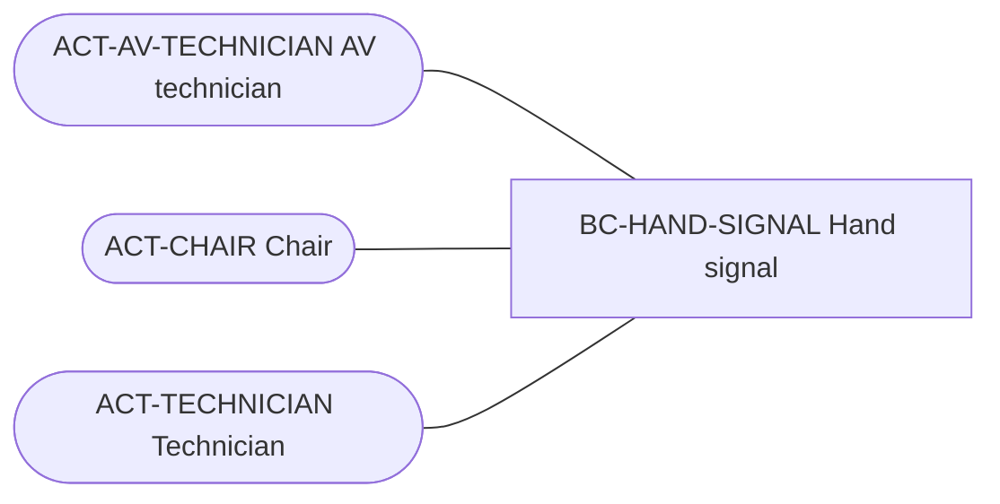

<!-- Generated by the forge-planning-and-requirements capture skill from the element files. Do not edit. -->

# Specification

Generated from the element files in this folder, one file per element. The files are the source; change them, never the generated pages.

[Status and open questions](STATUS.md) · [Actors](pages/actors.md) · [Glossary](pages/glossary.md) · [Parked ideas](parked.md)

## System areas

| Area | What it covers | Use cases | Requirements | Open questions |
|---|---|---|---|---|
| [BC-HAND-SIGNAL Hand signal](pages/hand-signal.md) | Notices raised hands in a Zoom meeting through the technician console, and shows them on a device on the chair's table. | 1 | 2 | 0 |

## Contents

Acceptance criteria are written next to what they verify.

### [BC-HAND-SIGNAL Hand signal](pages/hand-signal.md)

- Use cases
  - [UC-HAND-001](pages/hand-signal.md#uc-hand-001) Show a raised hand on the chair's device
- Constraints
  - [CON-ZOOM-WEBSDK](pages/hand-signal.md#con-zoom-websdk) Detect raised hands with the Zoom Meeting SDK for Web in the technician console
- Assumptions
  - [AS-WEBSDK-001](pages/hand-signal.md#as-websdk-001) The Web SDK shows every raised hand to an ordinary participant joined with ZAK
