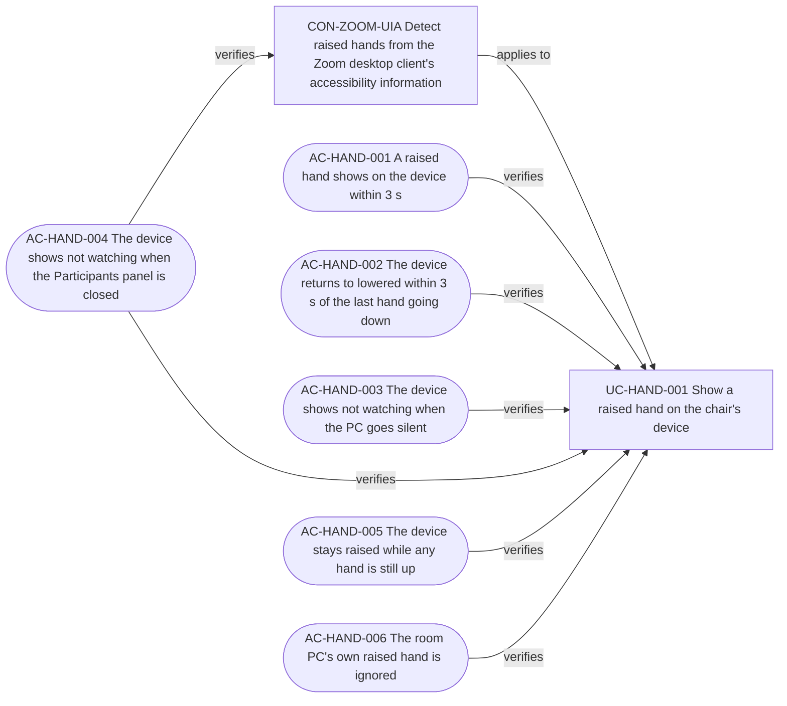

<!-- Generated by the forge-planning-and-requirements capture skill from the element files. Do not edit. -->

# BC-HAND-SIGNAL Hand signal

[Contents](../README.md)

*Notices raised hands in a Zoom meeting, as seen by the meeting room's Windows PC, and shows them on a device on the chair's table.*

Status: draft

**Responsibility**

In a hybrid meeting, tell the chair through a device on their table that someone in Zoom has raised a hand, stop once every hand is lowered, and make it evident when the system can't tell.

**Boundaries**

- Raising and lowering hands, and running the meeting, belong to Zoom.
- Detection works only through what the Zoom desktop client shows on the meeting room's Windows PC; it doesn't add a participant or use Zoom's servers (CON-ZOOM-UIA).
- Hands raised by the in-person audience aren't detected.
- The chair's tablet isn't part of the system.

**Interfaces**

- **Zoom desktop client (Windows):** the watcher on the PC reads the meeting window and the Participants panel.
- **Device (ESP32), over Wi-Fi:** the watcher on the PC repeatedly tells the device the current state; the device shows it.

Source: [system-areas/BC-HAND-SIGNAL.md](../system-areas/BC-HAND-SIGNAL.md)

## On this page

- [Use cases](#use-cases)
  - [UC-HAND-001](#uc-hand-001) Show a raised hand on the chair's device
- [Constraints](#constraints)
  - [CON-ZOOM-UIA](#con-zoom-uia) Detect raised hands from the Zoom desktop client's accessibility information
- [Assumptions](#assumptions)
  - [AS-ZOOM-UIA-001](#as-zoom-uia-001) The Participants panel exposes every raised hand and the own row through UI Automation

## Use cases

### UC-HAND-001 Show a raised hand on the chair's device

*While the meeting room's PC is in a Zoom meeting, the device on the chair's table shows whether any remote participant has a raised hand, and shows plainly when the system can't tell.*

Status: draft · system-area: [BC-HAND-SIGNAL](#bc-hand-signal) · primary-actor: [ACT-CHAIR](actors.md#act-chair) · supporting-actors: [ACT-TECHNICIAN](actors.md#act-technician) · governed-by: [CON-ZOOM-UIA](#con-zoom-uia) · uses-terms: [TERM-DEVICE-STATE](glossary.md#term-device-state) · verified by: [AC-HAND-001](#ac-hand-001), [AC-HAND-002](#ac-hand-002), [AC-HAND-003](#ac-hand-003), [AC-HAND-004](#ac-hand-004), [AC-HAND-005](#ac-hand-005), [AC-HAND-006](#ac-hand-006)

Details

**Goal**

The chair notices a raised hand in Zoom without watching a screen, so remote participants get the floor as reliably as people in the room.

**Trigger**

A remote participant raises their hand with Zoom's "Raise hand" feature.

**Preconditions**

- The technician has joined the meeting with the Zoom desktop client on the room's Windows PC, has the Participants panel open, and has the watcher running.
- The PC and the device are on a Wi-Fi network where they can reach each other, and the device is powered on the chair's table.

**Main flow**

1. A remote participant raises their hand in Zoom.
2. Within 3 s of the hand showing as raised in the room PC's Participants panel, the device shows **raised**.
3. The chair gives the floor; the participant lowers their hand, or the technician or host lowers it in Zoom.
4. Within 3 s of the last raised hand being lowered, the device shows **lowered**.

**Alternative flows**

- At 1, a hand raised by the room PC's own Zoom user is ignored; the device stays as it was.
- At 2, more hands go up while the device shows **raised**: it stays **raised**. At 4, it shows **lowered** only when no remote participant's hand is raised.
- At 3, a participant leaves the meeting with their hand raised: their hand no longer counts.

**Failure handling**

- After power-on, the device shows **not watching** until it receives a state from the PC.
- If the Participants panel is closed, the meeting ends, or Zoom stops running, the device shows **not watching** within 3 s. When the panel is open again in a meeting, the device shows the current state within 3 s.
- If the device hears nothing from the PC for 10 s (watcher stopped, PC off or asleep, Wi-Fi lost, the network blocks the two from reaching each other), the device shows **not watching** on its own.
- If the device loses power, it's dark, which the chair can see is not **lowered**.

**Out of scope**

- Zoom reactions other than "Raise hand", and hands raised on camera.
- How many hands are raised, or whose.
- Dismissing the signal from the device; it follows Zoom only.
- Breakout rooms: the room PC stays in the main meeting room.

Referenced by: [AC-HAND-001](#ac-hand-001), [AC-HAND-002](#ac-hand-002), [AC-HAND-003](#ac-hand-003), [AC-HAND-004](#ac-hand-004), [AC-HAND-005](#ac-hand-005), [AC-HAND-006](#ac-hand-006), [AS-ZOOM-UIA-001](#as-zoom-uia-001)

Source: [use-cases/UC-HAND-001.md](../use-cases/UC-HAND-001.md)

**What applies**

#### AC-HAND-001 A raised hand shows on the device within 3 s

*When a remote participant raises their hand, the device changes from lowered to raised within 3 seconds.*

Status: draft · verifies: [UC-HAND-001](#uc-hand-001) · uses-terms: [TERM-DEVICE-STATE](glossary.md#term-device-state)

Details

- **Given** The room PC is in a Zoom meeting with the Participants panel open and the watcher running; No hand is raised in the meeting; The device shows lowered
- **When** A remote participant raises their hand in Zoom
- **Then** The device shows raised within 3 s of the hand appearing as raised in the room PC's Participants panel
- Checked at: ui

**Intent**

Pins down the core promise and its 3-second limit.

Source: [acceptance-criteria/AC-HAND-001.md](../acceptance-criteria/AC-HAND-001.md)

#### AC-HAND-002 The device returns to lowered within 3 s of the last hand going down

*When the only raised hand is lowered, the device changes from raised to lowered within 3 seconds.*

Status: draft · verifies: [UC-HAND-001](#uc-hand-001) · uses-terms: [TERM-DEVICE-STATE](glossary.md#term-device-state)

Details

- **Given** The room PC is in a Zoom meeting with the Participants panel open and the watcher running; Exactly one remote participant has a raised hand; The device shows raised
- **When** That remote participant lowers their hand in Zoom
- **Then** The device shows lowered within 3 s of the hand appearing as lowered in the room PC's Participants panel
- Checked at: ui

**Intent**

Shows the signal follows Zoom back down, so the chair isn't left with a stale "raised".

Source: [acceptance-criteria/AC-HAND-002.md](../acceptance-criteria/AC-HAND-002.md)

#### AC-HAND-003 The device shows not watching when the PC goes silent

*When the device stops hearing from the PC, it shows not watching within 10 seconds, on its own.*

Status: draft · verifies: [UC-HAND-001](#uc-hand-001) · uses-terms: [TERM-DEVICE-STATE](glossary.md#term-device-state)

Details

- **Given** The room PC is in a Zoom meeting with the Participants panel open and the watcher running; The device shows lowered
- **When** The watcher on the PC is stopped
- **Then** The device shows not watching within 10 s
- Checked at: ui

**Intent**

The chair must never trust a "lowered" that nobody is backing up. This tests only the watcher being stopped. The PC going to sleep and Wi-Fi being lost aren't tested here; the use case's 10-second rule covers them.

Source: [acceptance-criteria/AC-HAND-003.md](../acceptance-criteria/AC-HAND-003.md)

#### AC-HAND-004 The device shows not watching when the Participants panel is closed

*When the PC can no longer see the Participants panel, the device shows not watching within 3 seconds.*

Status: draft · verifies: [UC-HAND-001](#uc-hand-001), [CON-ZOOM-UIA](#con-zoom-uia) · uses-terms: [TERM-DEVICE-STATE](glossary.md#term-device-state)

Details

- **Given** The room PC is in a Zoom meeting with the Participants panel open and the watcher running; The device shows lowered
- **When** The technician closes the Participants panel
- **Then** The device shows not watching within 3 s
- Checked at: ui

**Intent**

Closing the panel is the likeliest way to lose detection without anything crashing. The meeting ending or Zoom closing should behave the same way.

Source: [acceptance-criteria/AC-HAND-004.md](../acceptance-criteria/AC-HAND-004.md)

#### AC-HAND-005 The device stays raised while any hand is still up

*With two remote hands raised, lowering one keeps the device on raised; it shows lowered only after the second is lowered.*

Status: draft · verifies: [UC-HAND-001](#uc-hand-001) · uses-terms: [TERM-DEVICE-STATE](glossary.md#term-device-state)

Details

- **Given** The room PC is in a Zoom meeting with the Participants panel open and the watcher running; Two remote participants have a raised hand; The device shows raised
- **When** One of the two remote participants lowers their hand in Zoom
- **Then** The device still shows raised 5 s later
- Checked at: ui

**Intent**

The device must follow "any hand raised", not the last change, so a second waiting participant isn't dropped. AC-HAND-002 covers the device returning to lowered once the last hand goes down.

Source: [acceptance-criteria/AC-HAND-005.md](../acceptance-criteria/AC-HAND-005.md)

#### AC-HAND-006 The room PC's own raised hand is ignored

*A hand raised by the room PC's own Zoom user doesn't change the device from lowered.*

Status: draft · verifies: [UC-HAND-001](#uc-hand-001) · uses-terms: [TERM-DEVICE-STATE](glossary.md#term-device-state)

Details

- **Given** The room PC is in a Zoom meeting with the Participants panel open and the watcher running; No hand is raised in the meeting; The device shows lowered
- **When** The technician raises the room PC's own hand in Zoom
- **Then** The device still shows lowered 5 s later
- Checked at: ui

**Intent**

Only remote participants' hands count; the room PC's own hand would otherwise light the device for a hand nobody in Zoom is waiting with.

Source: [acceptance-criteria/AC-HAND-006.md](../acceptance-criteria/AC-HAND-006.md)

## Constraints

### CON-ZOOM-UIA Detect raised hands from the Zoom desktop client's accessibility information

*Raised hands are detected only by reading the accessibility information (Windows UI Automation) that the Zoom desktop client exposes on the user's own PC.*

Status: draft · verified by: [AC-HAND-004](#ac-hand-004)

Details

**Constraint**

The system shall learn which participants have a raised hand only from the accessibility information that the Zoom desktop client for Windows exposes through Windows UI Automation, on the meeting room's PC that the technician has in the meeting.

**Rationale**

It runs locally, needs no Zoom developer app, account approval or extra participant in the meeting, and can be built quickly. A Meeting SDK bot would be more robust but is visible to everyone in the meeting and much more work to build. Reading pixels from the screen breaks with themes, scaling and overlapping windows.

**Consequences**

- Rules out a Zoom Meeting SDK bot, Zoom REST APIs or webhooks, and screen capture or OCR.
- The Participants panel has to be open (docked or popped out) for raised hands to be visible.
- The Zoom client may be set to English or Finnish, so the watcher recognises the raised-hand and own-row text in both.
- Zoom updates may change that text. The technician can change it in a configuration file, without a new version of the watcher.
- Works only with the Zoom desktop client on Windows.

Referenced by: [AC-HAND-004](#ac-hand-004), [AS-ZOOM-UIA-001](#as-zoom-uia-001), [UC-HAND-001](#uc-hand-001)

Source: [constraints/CON-ZOOM-UIA.md](../constraints/CON-ZOOM-UIA.md)

## Assumptions

### AS-ZOOM-UIA-001 The Participants panel exposes every raised hand and the own row through UI Automation

*Through UI Automation, the Zoom desktop client's Participants panel exposes every participant's row, including rows scrolled out of view, with an accessible name that marks a raised hand and marks the room PC's own row, in English and in Finnish.*

Status: draft · affects: [CON-ZOOM-UIA](#con-zoom-uia), [UC-HAND-001](#uc-hand-001)

Details

**Assumption**

In the Zoom desktop client for Windows, through UI Automation:
1. Every participant row in the Participants panel can be read, including rows scrolled out of view.
2. A row's accessible name contains a fixed phrase while that participant's hand is raised (for example "raised hand"), and doesn't otherwise.
3. The room PC's own row can be recognised (for example by "(me)").
4. Points 2 and 3 hold with the client set to English and set to Finnish, each with its own known phrases.

**Basis**

Zoom supports screen readers, which read out each participant's state, including a raised hand. Nobody has checked yet with inspect.exe or Accessibility Insights on the room's Zoom version, in either language.

**If wrong**

- Point 1: Zoom lists raised hands first, so a raised hand would rarely be out of view. If rows out of view can't be read, the watcher can read only the visible rows, and the spec must say so. A hidden raised hand would show a false **lowered**.
- Point 2 or 3: look for another UI Automation property that carries the state (an icon element's name, help text) before giving up on CON-ZOOM-UIA. Otherwise reopen the choice of approach, with the Meeting SDK bot next in line.
- Point 4: support only the language that works, and require the technician to set the client to it.

Source: [assumptions/AS-ZOOM-UIA-001.md](../assumptions/AS-ZOOM-UIA-001.md)

