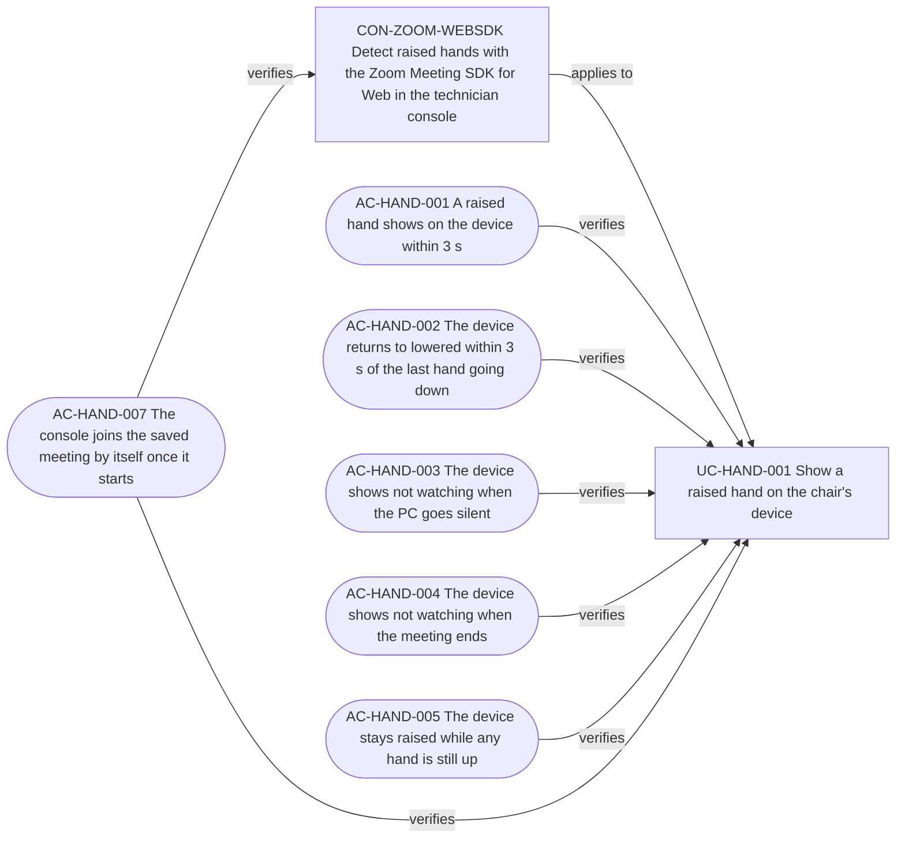

<!-- Generated by the forge-planning-and-requirements capture skill from the element files. Do not edit. -->

# BC-HAND-SIGNAL Hand signal

[Contents](../README.md)

*Notices raised hands in a Zoom meeting through the technician console, and shows them on a device on the chair's table.*

Status: draft

**Responsibility**

In a hybrid meeting, tell the chair through a device on their table that someone in Zoom has raised a hand, stop once every hand is lowered, and make it evident when the system can't tell.

**Boundaries**

- Raising and lowering hands, and running the meeting, belong to Zoom.
- The room's audio and video belong to the AV technician's Zoom desktop client on the room PC.
- Detection works only through the technician console (CON-ZOOM-WEBSDK).
- Hands raised by the in-person audience aren't detected.
- The chair's tablet isn't part of the system.

**Interfaces**

- **Zoom:** the technician console joins the meeting as the technician's Zoom user and receives each participant's raised-hand status.
- **Device (ESP32), over Wi-Fi:** the technician console repeatedly tells the device the current state; the device shows it.

Source: [system-areas/BC-HAND-SIGNAL.md](../system-areas/BC-HAND-SIGNAL.md)

## On this page

- [Use cases](#use-cases)
  - [UC-HAND-001](#uc-hand-001) Show a raised hand on the chair's device
- [Constraints](#constraints)
  - [CON-ZOOM-WEBSDK](#con-zoom-websdk) Detect raised hands with the Zoom Meeting SDK for Web in the technician console
- [Assumptions](#assumptions)
  - [AS-WEBSDK-001](#as-websdk-001) The Web SDK shows every raised hand to an ordinary participant joined with ZAK

## Use cases

### UC-HAND-001 Show a raised hand on the chair's device

*While the technician console is in the Zoom meeting, the device on the chair's table shows whether any remote participant has a raised hand, and shows plainly when the system can't tell.*

Status: draft · system-area: [BC-HAND-SIGNAL](#bc-hand-signal) · primary-actor: [ACT-CHAIR](actors.md#act-chair) · supporting-actors: [ACT-TECHNICIAN](actors.md#act-technician), [ACT-AV-TECHNICIAN](actors.md#act-av-technician) · governed-by: [CON-ZOOM-WEBSDK](#con-zoom-websdk) · uses-terms: [TERM-DEVICE-STATE](glossary.md#term-device-state), [TERM-TECHNICIAN-CONSOLE](glossary.md#term-technician-console) · verified by: [AC-HAND-001](#ac-hand-001), [AC-HAND-002](#ac-hand-002), [AC-HAND-003](#ac-hand-003), [AC-HAND-004](#ac-hand-004), [AC-HAND-005](#ac-hand-005), [AC-HAND-007](#ac-hand-007)

Details

**Goal**

The chair notices a raised hand in Zoom without watching a screen, so remote participants get the floor as reliably as people in the room.

**Trigger**

A remote participant raises their hand with Zoom's "Raise hand" feature.

**Preconditions**

- The technician has signed in to Zoom in the console, the usual meeting ID and passcode are saved, and the console is running.
- The console has joined the meeting, with no microphone and no camera, and has been admitted from the waiting room. It doesn't need to be co-host.
- The technician's PC and the device are on a Wi-Fi network where they can reach each other, and the device is powered on the chair's table.

**Main flow**

1. A remote participant raises their hand in Zoom.
2. Within 3 s, the device shows **raised**.
3. The chair gives the floor; the participant lowers their hand, or a host or co-host lowers it in Zoom.
4. Within 3 s of the last raised hand being lowered, the device shows **lowered**.

**Alternative flows**

- Before 1, joining: when the console starts, it joins the saved meeting by itself, and the device shows **not watching** until the console is in the meeting. If the meeting hasn't started, the console tries again every 30 s. If it's in the waiting room, it waits there. Once admitted, the device shows the current state within 3 s.
- At 2, more hands go up while the device shows **raised**: it stays **raised**. At 4, it shows **lowered** only when no remote participant's hand is raised.
- At 3, a participant leaves the meeting with their hand raised: their hand no longer counts.

**Failure handling**

- After power-on, the device shows **not watching** until it receives a state from the technician's PC.
- If Zoom refuses the join (wrong saved meeting ID or passcode, meeting locked, app not authorised), the console shows the technician the reason, and the device shows **not watching**.
- If the console leaves the meeting, is removed, or the meeting ends, the device shows **not watching** within 3 s.
- If the device hears nothing from the technician's PC for 10 s (console stopped, PC off or asleep, Wi-Fi lost, the network blocks the two from reaching each other), the device shows **not watching** on its own.
- If the technician's sign-in can't be renewed, the console asks them to sign in again, and the device shows **not watching** until the console is back in the meeting.
- If the device loses power, it's dark, which the chair can see is not **lowered**.

**Out of scope**

- Zoom reactions other than "Raise hand", and hands raised on camera.
- How many hands are raised, or whose.
- Dismissing the signal from the device; it follows Zoom only.
- Breakout rooms: the console stays in the main meeting room.

Referenced by: [AC-HAND-001](#ac-hand-001), [AC-HAND-002](#ac-hand-002), [AC-HAND-003](#ac-hand-003), [AC-HAND-004](#ac-hand-004), [AC-HAND-005](#ac-hand-005), [AC-HAND-007](#ac-hand-007), [AS-WEBSDK-001](#as-websdk-001)

Source: [use-cases/UC-HAND-001.md](../use-cases/UC-HAND-001.md)

**What applies**

#### AC-HAND-001 A raised hand shows on the device within 3 s

*When a remote participant raises their hand, the device changes from lowered to raised within 3 seconds.*

Status: draft · verifies: [UC-HAND-001](#uc-hand-001) · uses-terms: [TERM-DEVICE-STATE](glossary.md#term-device-state), [TERM-TECHNICIAN-CONSOLE](glossary.md#term-technician-console)

Details

- **Given** The technician console is in the Zoom meeting and the device is receiving its state; No hand is raised in the meeting; The device shows lowered
- **When** A remote participant raises their hand in Zoom
- **Then** The device shows raised within 3 s of the participant raising it
- Checked at: ui

**Intent**

Pins down the core promise and its 3-second limit.

Source: [acceptance-criteria/AC-HAND-001.md](../acceptance-criteria/AC-HAND-001.md)

#### AC-HAND-002 The device returns to lowered within 3 s of the last hand going down

*When the only raised hand is lowered, the device changes from raised to lowered within 3 seconds.*

Status: draft · verifies: [UC-HAND-001](#uc-hand-001) · uses-terms: [TERM-DEVICE-STATE](glossary.md#term-device-state), [TERM-TECHNICIAN-CONSOLE](glossary.md#term-technician-console)

Details

- **Given** The technician console is in the Zoom meeting and the device is receiving its state; Exactly one remote participant has a raised hand; The device shows raised
- **When** That remote participant lowers their hand in Zoom
- **Then** The device shows lowered within 3 s of the participant lowering it
- Checked at: ui

**Intent**

Shows the signal follows Zoom back down, so the chair isn't left with a stale "raised".

Source: [acceptance-criteria/AC-HAND-002.md](../acceptance-criteria/AC-HAND-002.md)

#### AC-HAND-003 The device shows not watching when the PC goes silent

*When the device stops hearing from the PC, it shows not watching within 10 seconds, on its own.*

Status: draft · verifies: [UC-HAND-001](#uc-hand-001) · uses-terms: [TERM-DEVICE-STATE](glossary.md#term-device-state), [TERM-TECHNICIAN-CONSOLE](glossary.md#term-technician-console)

Details

- **Given** The technician console is in the Zoom meeting and the device is receiving its state; The device shows lowered
- **When** The program on the technician's PC is stopped
- **Then** The device shows not watching within 10 s
- Checked at: ui

**Intent**

The chair must never trust a "lowered" that nobody is backing up. This tests only the console program being stopped. The PC going to sleep and Wi-Fi being lost aren't tested here; the use case's 10-second rule covers them.

Source: [acceptance-criteria/AC-HAND-003.md](../acceptance-criteria/AC-HAND-003.md)

#### AC-HAND-004 The device shows not watching when the meeting ends

*When the host ends the meeting, the device shows not watching within 3 seconds.*

Status: draft · verifies: [UC-HAND-001](#uc-hand-001) · uses-terms: [TERM-DEVICE-STATE](glossary.md#term-device-state), [TERM-TECHNICIAN-CONSOLE](glossary.md#term-technician-console)

Details

- **Given** The technician console is in the Zoom meeting and the device is receiving its state; The device shows lowered
- **When** The host ends the meeting for all
- **Then** The device shows not watching within 3 s
- Checked at: ui

**Intent**

The meeting ends every time, while the console keeps running; the chair must not be left with a "lowered" nobody is backing up. The console being removed or sent back to the waiting room is covered by UC-HAND-001's failure handling and should behave the same way.

Source: [acceptance-criteria/AC-HAND-004.md](../acceptance-criteria/AC-HAND-004.md)

#### AC-HAND-005 The device stays raised while any hand is still up

*With two remote hands raised, lowering one keeps the device on raised; it shows lowered only after the second is lowered.*

Status: draft · verifies: [UC-HAND-001](#uc-hand-001) · uses-terms: [TERM-DEVICE-STATE](glossary.md#term-device-state), [TERM-TECHNICIAN-CONSOLE](glossary.md#term-technician-console)

Details

- **Given** The technician console is in the Zoom meeting and the device is receiving its state; Two remote participants have a raised hand; The device shows raised
- **When** One of the two remote participants lowers their hand in Zoom
- **Then** The device still shows raised 5 s later
- Checked at: ui

**Intent**

The device must follow "any hand raised", not the last change, so a second waiting participant isn't dropped. AC-HAND-002 covers the device returning to lowered once the last hand goes down.

Source: [acceptance-criteria/AC-HAND-005.md](../acceptance-criteria/AC-HAND-005.md)

#### AC-HAND-007 The console joins the saved meeting by itself once it starts

*A console started before the meeting joins on its own, and the device goes from not watching to lowered within 33 seconds of the console being admitted.*

Status: draft · verifies: [UC-HAND-001](#uc-hand-001), [CON-ZOOM-WEBSDK](#con-zoom-websdk) · uses-terms: [TERM-DEVICE-STATE](glossary.md#term-device-state), [TERM-TECHNICIAN-CONSOLE](glossary.md#term-technician-console)

Details

- **Given** The technician is signed in, and the usual meeting ID and passcode are saved in the console; The meeting, hosted on another Zoom account, hasn't started; The console has been started and the device shows not watching
- **When** The host starts the meeting and admits the console from the waiting room as soon as it appears there
- **Then** The console appears in the meeting under the technician's name, with no microphone and no camera; The device shows lowered within 33 s of the meeting starting
- Checked at: ui

**Intent**

Pins down joining without the technician's help: one 30-second retry at most, then 3 s to show the current state. It also proves the console can join a meeting on another account as the technician.

Source: [acceptance-criteria/AC-HAND-007.md](../acceptance-criteria/AC-HAND-007.md)

## Constraints

### CON-ZOOM-WEBSDK Detect raised hands with the Zoom Meeting SDK for Web in the technician console

*Raised hands are detected only by the technician console, built on the Zoom Meeting SDK for Web and joined as the technician's own signed-in Zoom user, with no cloud server.*

Status: draft · uses-terms: [TERM-TECHNICIAN-CONSOLE](glossary.md#term-technician-console) · verified by: [AC-HAND-007](#ac-hand-007)

Details

**Constraint**

The system shall learn which participants have a raised hand only from the participant information the Zoom Meeting SDK for Web gives the technician console. The console runs on the technician's own PC and joins the meeting as the technician's own signed-in Zoom user (ZAK token).

**Rationale**

The participant information carries a raised-hand flag, so detection doesn't depend on the Zoom client's display language, an open panel or rows in view. The meetings are hosted on a Zoom account other than the one the developer app is created in. Since 2026-03-02, Zoom requires SDK apps joining such meetings to be attributed to a signed-in user. An OBF token only works while that user is already in the meeting on another client, which the technician isn't, so the console joins as the technician themselves.

**Consequences**

- Rules out reading the Zoom desktop client's screen-reader information or the screen, and Zoom REST APIs or webhooks.
- The console is a web page served at localhost by a small program on the technician's PC. There's no cloud server.
- The program keeps the technician's Zoom sign-in, renews it, and gets the token the page joins with.
- A Zoom developer app signs the join requests. Its secret is never sent to the browser page; only the program on the technician's PC holds it.
- The program, not the page, talks to the device over Wi-Fi.
- The technician needs a Zoom account.
- The console is a participant in the meeting, visible to everyone under the technician's name.
- The room's own audio and video stay on the Zoom desktop client, run by the AV technician.

Referenced by: [AC-HAND-007](#ac-hand-007), [AS-WEBSDK-001](#as-websdk-001), [UC-HAND-001](#uc-hand-001)

Source: [constraints/CON-ZOOM-WEBSDK.md](../constraints/CON-ZOOM-WEBSDK.md)

## Assumptions

### AS-WEBSDK-001 The Web SDK shows every raised hand to an ordinary participant joined with ZAK

*A console joined to an outside meeting as the technician's signed-in user, without co-host rights, sees every participant's raised hand through the SDK within a second or two of each change.*

Status: draft · affects: [CON-ZOOM-WEBSDK](#con-zoom-websdk), [UC-HAND-001](#uc-hand-001)

Details

**Assumption**

1. A Meeting SDK for Web client can join a meeting hosted on another Zoom account using the technician's ZAK token.
2. Joined as an ordinary participant (not host or co-host), it receives every other participant's raised-hand flag (`bRaiseHand`) in the participant list.
3. A raise or lower is visible to the console within 2 s, either through the participant-update event or by re-reading the participant list.
4. The console's own participant can be told apart from the others.
5. A developer app that isn't published or approved on the Zoom Marketplace may join meetings on another account with ZAK; if approval is needed, it can be obtained for an internal-only app.

**Basis**

Zoom documents `bRaiseHand` and says the participant-update event fires on raise hand. Developers have counted raised hands with `bRaiseHand` since 2020. Nothing found says whether non-hosts see others' hands. Forum reports show bugs: "Lower all hands" updating only one hand (2021, SDK 2.0.0) and disconnects tied to the update listener (2025, SDK 3.12.0); neither is confirmed fixed. Nobody has tested this.

**If wrong**

- Point 1: the console can't join; reconsider OBF with the technician also on Zoom desktop, or a meeting on the app's own account.
- Point 2: the console must be co-host before it detects hands; until then the device shows **not watching**.
- Point 3: re-read the participant list on a timer and accept a longer limit than 3 s in UC-HAND-001.
- Point 4: recognise the console's own participant by the name it joins with.
- Point 5: the console can't join outside meetings until the app is approved; if approval isn't available, reconsider the approach.

Source: [assumptions/AS-WEBSDK-001.md](../assumptions/AS-WEBSDK-001.md)

