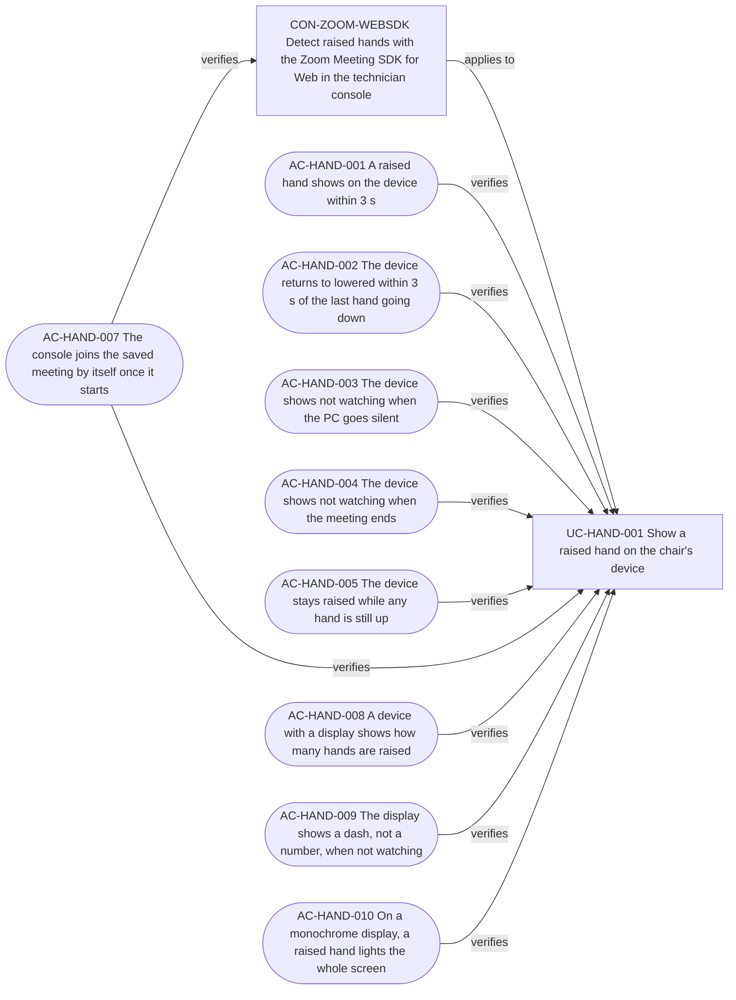

<!-- Generated by the forge-planning-and-requirements capture skill from the element files. Do not edit. -->

# BC-HAND-SIGNAL Hand signal

[Contents](../README.md)

*Notices raised hands in a Zoom meeting through the technician console, and shows them on a device on the chair's table.*

Status: agreed

**Responsibility**

In a hybrid meeting, tell the chair through a device on their table that someone in Zoom has raised a hand, stop once every hand is lowered, and make it evident when the system can't tell.

**Boundaries**

- Raising and lowering hands, and running the meeting, belong to Zoom.
- The room's audio and video belong to the AV technician's Zoom desktop client on the room PC.
- Detection works only through the technician console (CON-ZOOM-WEBSDK).
- Hands raised by the in-person audience aren't detected.
- The chair's tablet isn't part of the system.

**Interfaces**

- **Zoom:** the technician console joins the meeting under its configured name and receives each participant's raised-hand status.
- **Device (ESP32), over Wi-Fi:** the technician console repeatedly tells the device the current state and, for a device with a display, the number of raised remote hands; the device shows them.

Source: [system-areas/BC-HAND-SIGNAL.md](../system-areas/BC-HAND-SIGNAL.md)

## On this page

- [Use cases](#use-cases)
  - [UC-HAND-001](#uc-hand-001) Show a raised hand on the chair's device
- [Constraints](#constraints)
  - [CON-ZOOM-WEBSDK](#con-zoom-websdk) Detect raised hands with the Zoom Meeting SDK for Web in the technician console

## Use cases

### UC-HAND-001 Show a raised hand on the chair's device

*While the technician console is in the Zoom meeting, the device on the chair's table shows whether any remote participant has a raised hand, and shows plainly when the system can't tell.*

Status: agreed · system-area: [BC-HAND-SIGNAL](#bc-hand-signal) · primary-actor: [ACT-CHAIR](actors.md#act-chair) · supporting-actors: [ACT-TECHNICIAN](actors.md#act-technician), [ACT-AV-TECHNICIAN](actors.md#act-av-technician) · governed-by: [CON-ZOOM-WEBSDK](#con-zoom-websdk) · uses-terms: [TERM-DEVICE-STATE](glossary.md#term-device-state), [TERM-TECHNICIAN-CONSOLE](glossary.md#term-technician-console) · verified by: [AC-HAND-001](#ac-hand-001), [AC-HAND-002](#ac-hand-002), [AC-HAND-003](#ac-hand-003), [AC-HAND-004](#ac-hand-004), [AC-HAND-005](#ac-hand-005), [AC-HAND-007](#ac-hand-007), [AC-HAND-008](#ac-hand-008), [AC-HAND-009](#ac-hand-009), [AC-HAND-010](#ac-hand-010)

Details

**Goal**

The chair notices a raised hand in Zoom without watching a screen, so remote participants get the floor as reliably as people in the room.

**Trigger**

A remote participant raises their hand with Zoom's "Raise hand" feature.

**Preconditions**

- The meeting is hosted on the Zoom account the console's Zoom app belongs to (CON-ZOOM-WEBSDK).
- The usual meeting ID and passcode are saved in the console, and the console is running.
- The console has joined the meeting, with no microphone and no camera, and has been admitted from the waiting room. It doesn't need to be co-host.
- The technician's PC and the device are on a Wi-Fi network where they can reach each other, and the device is powered on the chair's table.

**Main flow**

1. A remote participant raises their hand in Zoom.
2. Within 3 s, the device shows **raised**.
3. The chair gives the floor; the participant lowers their hand, or a host or co-host lowers it in Zoom.
4. Within 3 s of the last raised hand being lowered, the device shows **lowered**.

**Alternative flows**

- Before 1, joining: when the console starts, it joins the saved meeting by itself, and the device shows **not watching** until the console is in the meeting. If the meeting hasn't started, the console tries again every 30 s. If it's in the waiting room, it waits there. Once admitted, the device shows the current state within 3 s.
- At 2, more hands go up while the device shows **raised**: it stays **raised**. At 4, it shows **lowered** only when no remote participant's hand is raised.
- At 3, a participant leaves the meeting with their hand raised: their hand no longer counts.
- Where the device has a display, the chair must notice **raised** before anything else; how many hands are raised is secondary and must never make **raised** harder to notice. The display shows a number, updated within 3 s of any change in the number of raised remote hands or in the state: **0** when **lowered**; the number of remote participants with a raised hand, **1** to **9**, or **9+** above nine, when **raised**; a dash (**–**) when **not watching**, never a number.
- Where the display is monochrome, whether or not an RGB LED is also fitted: **raised** lights the whole display, with the number dark on the lit background. **Lowered** shows a light "0" on an otherwise unlit display. **Not watching** shows a light "–" and a line of text: the device's address when it's on Wi-Fi, otherwise "no wifi". **Lowered** and **raised** may also show a short label.

**Failure handling**

- After power-on, the device shows **not watching** until it receives a state from the technician's PC.
- If Zoom refuses the join (wrong saved meeting ID or passcode, meeting locked, meeting hosted on another account, Meeting SDK turned off in the Zoom app), the console shows the technician the reason, and the device shows **not watching**.
- If the console leaves the meeting, is removed, or the meeting ends, the device shows **not watching** within 3 s.
- If the device hears nothing from the technician's PC for 10 s (console stopped, PC off or asleep, Wi-Fi lost, the network blocks the two from reaching each other), the device shows **not watching** on its own.
- If the device loses power, it's dark, which the chair can see is not **lowered**.

**Out of scope**

- Zoom reactions other than "Raise hand", and hands raised on camera.
- Whose hands are raised, or in which order.
- Dismissing the signal from the device; it follows Zoom only.
- Breakout rooms: the console stays in the main meeting room.

Referenced by: [AC-HAND-001](#ac-hand-001), [AC-HAND-002](#ac-hand-002), [AC-HAND-003](#ac-hand-003), [AC-HAND-004](#ac-hand-004), [AC-HAND-005](#ac-hand-005), [AC-HAND-007](#ac-hand-007), [AC-HAND-008](#ac-hand-008), [AC-HAND-009](#ac-hand-009), [AC-HAND-010](#ac-hand-010)

Source: [use-cases/UC-HAND-001.md](../use-cases/UC-HAND-001.md)

**What applies**

#### AC-HAND-001 A raised hand shows on the device within 3 s

*When a remote participant raises their hand, the device changes from lowered to raised within 3 seconds.*

Status: agreed · verifies: [UC-HAND-001](#uc-hand-001) · uses-terms: [TERM-DEVICE-STATE](glossary.md#term-device-state), [TERM-TECHNICIAN-CONSOLE](glossary.md#term-technician-console)

Details

- **Given** The technician console is in the Zoom meeting and the device is receiving its state; No hand is raised in the meeting; The device shows lowered
- **When** A remote participant raises their hand in Zoom
- **Then** The device shows raised within 3 s of the participant raising it
- Checked at: ui

**Intent**

Pins down the core promise and its 3-second limit.

Source: [acceptance-criteria/AC-HAND-001.md](../acceptance-criteria/AC-HAND-001.md)

#### AC-HAND-002 The device returns to lowered within 3 s of the last hand going down

*When the only raised hand is lowered, the device changes from raised to lowered within 3 seconds.*

Status: agreed · verifies: [UC-HAND-001](#uc-hand-001) · uses-terms: [TERM-DEVICE-STATE](glossary.md#term-device-state), [TERM-TECHNICIAN-CONSOLE](glossary.md#term-technician-console)

Details

- **Given** The technician console is in the Zoom meeting and the device is receiving its state; Exactly one remote participant has a raised hand; The device shows raised
- **When** That remote participant lowers their hand in Zoom
- **Then** The device shows lowered within 3 s of the participant lowering it
- Checked at: ui

**Intent**

Shows the signal follows Zoom back down, so the chair isn't left with a stale "raised".

Source: [acceptance-criteria/AC-HAND-002.md](../acceptance-criteria/AC-HAND-002.md)

#### AC-HAND-003 The device shows not watching when the PC goes silent

*When the device stops hearing from the PC, it shows not watching within 10 seconds, on its own.*

Status: agreed · verifies: [UC-HAND-001](#uc-hand-001) · uses-terms: [TERM-DEVICE-STATE](glossary.md#term-device-state), [TERM-TECHNICIAN-CONSOLE](glossary.md#term-technician-console)

Details

- **Given** The technician console is in the Zoom meeting and the device is receiving its state; The device shows lowered
- **When** The program on the technician's PC is stopped
- **Then** The device shows not watching within 10 s
- Checked at: ui

**Intent**

The chair must never trust a "lowered" that nobody is backing up. This tests only the console program being stopped. The PC going to sleep and Wi-Fi being lost aren't tested here; the use case's 10-second rule covers them.

Source: [acceptance-criteria/AC-HAND-003.md](../acceptance-criteria/AC-HAND-003.md)

#### AC-HAND-004 The device shows not watching when the meeting ends

*When the host ends the meeting, the device shows not watching within 3 seconds.*

Status: agreed · verifies: [UC-HAND-001](#uc-hand-001) · uses-terms: [TERM-DEVICE-STATE](glossary.md#term-device-state), [TERM-TECHNICIAN-CONSOLE](glossary.md#term-technician-console)

Details

- **Given** The technician console is in the Zoom meeting and the device is receiving its state; The device shows lowered
- **When** The host ends the meeting for all
- **Then** The device shows not watching within 3 s
- Checked at: ui

**Intent**

The meeting ends every time, while the console keeps running; the chair must not be left with a "lowered" nobody is backing up. The console being removed or sent back to the waiting room is covered by UC-HAND-001's failure handling and should behave the same way.

Source: [acceptance-criteria/AC-HAND-004.md](../acceptance-criteria/AC-HAND-004.md)

#### AC-HAND-005 The device stays raised while any hand is still up

*With two remote hands raised, lowering one keeps the device on raised; it shows lowered only after the second is lowered.*

Status: agreed · verifies: [UC-HAND-001](#uc-hand-001) · uses-terms: [TERM-DEVICE-STATE](glossary.md#term-device-state), [TERM-TECHNICIAN-CONSOLE](glossary.md#term-technician-console)

Details

- **Given** The technician console is in the Zoom meeting and the device is receiving its state; Two remote participants have a raised hand; The device shows raised
- **When** One of the two remote participants lowers their hand in Zoom
- **Then** The device still shows raised 5 s later
- Checked at: ui

**Intent**

The device must follow "any hand raised", not the last change, so a second waiting participant isn't dropped. AC-HAND-002 covers the device returning to lowered once the last hand goes down.

Source: [acceptance-criteria/AC-HAND-005.md](../acceptance-criteria/AC-HAND-005.md)

#### AC-HAND-007 The console joins the saved meeting by itself once it starts

*A console started before the meeting joins on its own, and the device goes from not watching to lowered within 33 seconds of the console being admitted.*

Status: agreed · verifies: [UC-HAND-001](#uc-hand-001), [CON-ZOOM-WEBSDK](#con-zoom-websdk) · uses-terms: [TERM-DEVICE-STATE](glossary.md#term-device-state), [TERM-TECHNICIAN-CONSOLE](glossary.md#term-technician-console)

Details

- **Given** The usual meeting ID and passcode are saved in the console; The meeting, hosted on the account the console's Zoom app belongs to, hasn't started; The console has been started and the device shows not watching
- **When** The host starts the meeting and admits the console from the waiting room as soon as it appears there
- **Then** The console appears in the meeting under its configured name, with no microphone and no camera; The device shows lowered within 33 s of the meeting starting
- Checked at: ui

**Intent**

Pins down joining without the technician's help: one 30-second retry at most, then 3 s to show the current state. It also proves the console joins without anyone signing in.

Source: [acceptance-criteria/AC-HAND-007.md](../acceptance-criteria/AC-HAND-007.md)

#### AC-HAND-008 A device with a display shows how many hands are raised

*With two remote hands raised the display shows 2, and after one is lowered it shows 1, each within 3 seconds.*

Status: agreed · verifies: [UC-HAND-001](#uc-hand-001) · uses-terms: [TERM-DEVICE-STATE](glossary.md#term-device-state), [TERM-TECHNICIAN-CONSOLE](glossary.md#term-technician-console)

Details

- **Given** The device has a display; The technician console is in the Zoom meeting and the device is receiving its state; Two remote participants have a raised hand; The device shows raised and the display shows 2
- **When** One of the two remote participants lowers their hand in Zoom
- **Then** The display shows 1 within 3 s of the participant lowering their hand; The device still shows raised
- Checked at: ui

**Intent**

Proves the display shows the count, not just "any hand raised": an "any hand" signal would still show something non-zero, but not change from 2 to 1.

Source: [acceptance-criteria/AC-HAND-008.md](../acceptance-criteria/AC-HAND-008.md)

#### AC-HAND-009 The display shows a dash, not a number, when not watching

*When the console leaves the meeting while a hand is raised, the display replaces the count with a dash within 3 seconds.*

Status: agreed · verifies: [UC-HAND-001](#uc-hand-001) · uses-terms: [TERM-DEVICE-STATE](glossary.md#term-device-state), [TERM-TECHNICIAN-CONSOLE](glossary.md#term-technician-console)

Details

- **Given** The device has a display; The technician console is in the Zoom meeting and the device is receiving its state; One remote participant has a raised hand; The device shows raised and the display shows 1
- **When** A host or co-host removes the technician console from the meeting
- **Then** The device shows not watching within 3 s; The display shows "–" and no number
- Checked at: ui

**Intent**

A count left on the display after the system stopped watching would look current and mislead the chair; this pins down that it's cleared.

Source: [acceptance-criteria/AC-HAND-009.md](../acceptance-criteria/AC-HAND-009.md)

#### AC-HAND-010 On a monochrome display, a raised hand lights the whole screen

*Without an RGB LED, a raised hand turns the mostly unlit display into a fully lit one with the count dark on it, within 3 seconds.*

Status: agreed · verifies: [UC-HAND-001](#uc-hand-001) · uses-terms: [TERM-DEVICE-STATE](glossary.md#term-device-state), [TERM-TECHNICIAN-CONSOLE](glossary.md#term-technician-console)

Details

- **Given** The device has a monochrome display and no RGB LED; The technician console is in the Zoom meeting and the device is receiving its state; No remote participant has a raised hand; The display shows a light "0" on an otherwise unlit screen
- **When** A remote participant raises their hand in Zoom
- **Then** Within 3 s of the participant raising it, the whole display is lit; The number 1 shows dark on the lit background
- Checked at: ui

**Intent**

Noticing that someone has raised a hand is the most important thing the device does. Without colours, the change from a mostly unlit to a fully lit screen is what makes it noticeable.

Source: [acceptance-criteria/AC-HAND-010.md](../acceptance-criteria/AC-HAND-010.md)

## Constraints

### CON-ZOOM-WEBSDK Detect raised hands with the Zoom Meeting SDK for Web in the technician console

*Raised hands are detected only by the technician console, built on the Zoom Meeting SDK for Web with a Zoom app created in the account that hosts the meetings, joined under a configured name with no user sign-in and no cloud server.*

Status: agreed · uses-terms: [TERM-TECHNICIAN-CONSOLE](glossary.md#term-technician-console) · verified by: [AC-HAND-007](#ac-hand-007)

Details

**Constraint**

The system shall learn which participants have a raised hand only from the participant information the Zoom Meeting SDK for Web gives the technician console. The console uses a Zoom app created in the Zoom account that hosts the meetings, and joins with that app's SDK signature under a name set in its configuration, without signing in a Zoom user.

**Rationale**

The participant information carries a raised-hand flag, so detection doesn't depend on the Zoom client's display language, an open panel or rows in view. The test showed that an unpublished app from another account is refused with error 4011 ("cross account join error"), whether it joins with the technician's ZAK or with an OBF token. An app created in the hosting account joins that account's meetings with only its signature. Publishing the app on the Zoom Marketplace was rejected as too much for a single-room device.

**Consequences**

- Rules out reading the Zoom desktop client's screen-reader information or the screen, and Zoom REST APIs or webhooks.
- The project owner creates and looks after the Zoom app in the hosting account, and keeps Meeting SDK enabled in it. Meetings hosted on any other account can't be watched.
- The technician needs no Zoom account and doesn't sign in.
- The console is a web page served at localhost by a small program on the technician's PC. There's no cloud server.
- The app's secret is never sent to the browser page; only the program on the technician's PC holds it.
- The program, not the page, talks to the device over Wi-Fi.
- The console re-reads the whole participant list at least every 500 ms instead of relying on change events alone: in the test, "Lower all hands" lowered two hands but sent an event for only one.
- The console is a participant in the meeting, visible to everyone under its configured name.
- The room's own audio and video stay on the Zoom desktop client, run by the AV technician.

Referenced by: [AC-HAND-007](#ac-hand-007), [UC-HAND-001](#uc-hand-001)

Source: [constraints/CON-ZOOM-WEBSDK.md](../constraints/CON-ZOOM-WEBSDK.md)

